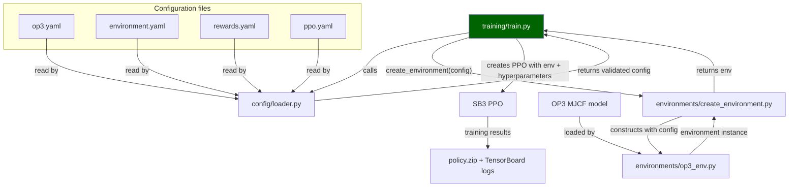
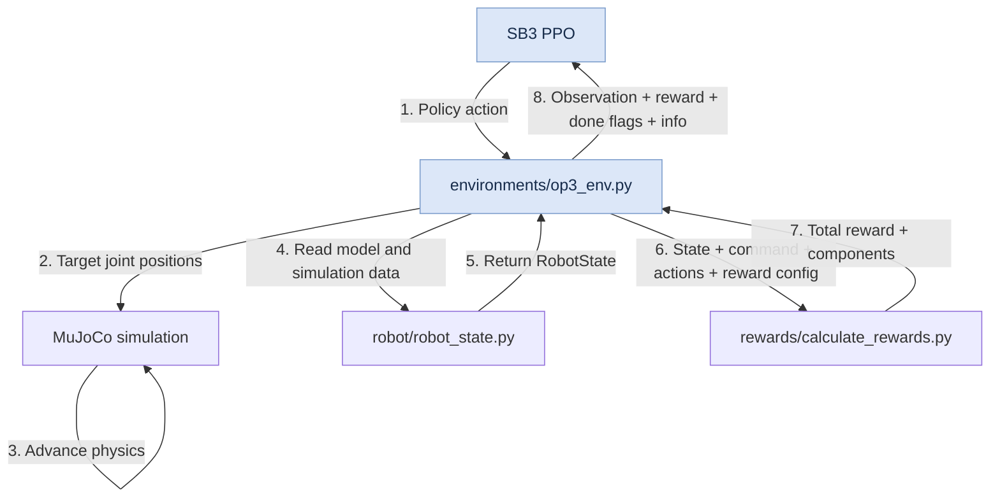

# OP3 architecture flowcharts

## Initialization and training setup

Shows how configuration and the robot model feed environment construction and PPO training.

## One policy step

This is what happens inside op3_env.py. Shows the action, physics, state-reading, and reward sequence that returns a transition to PPO.

